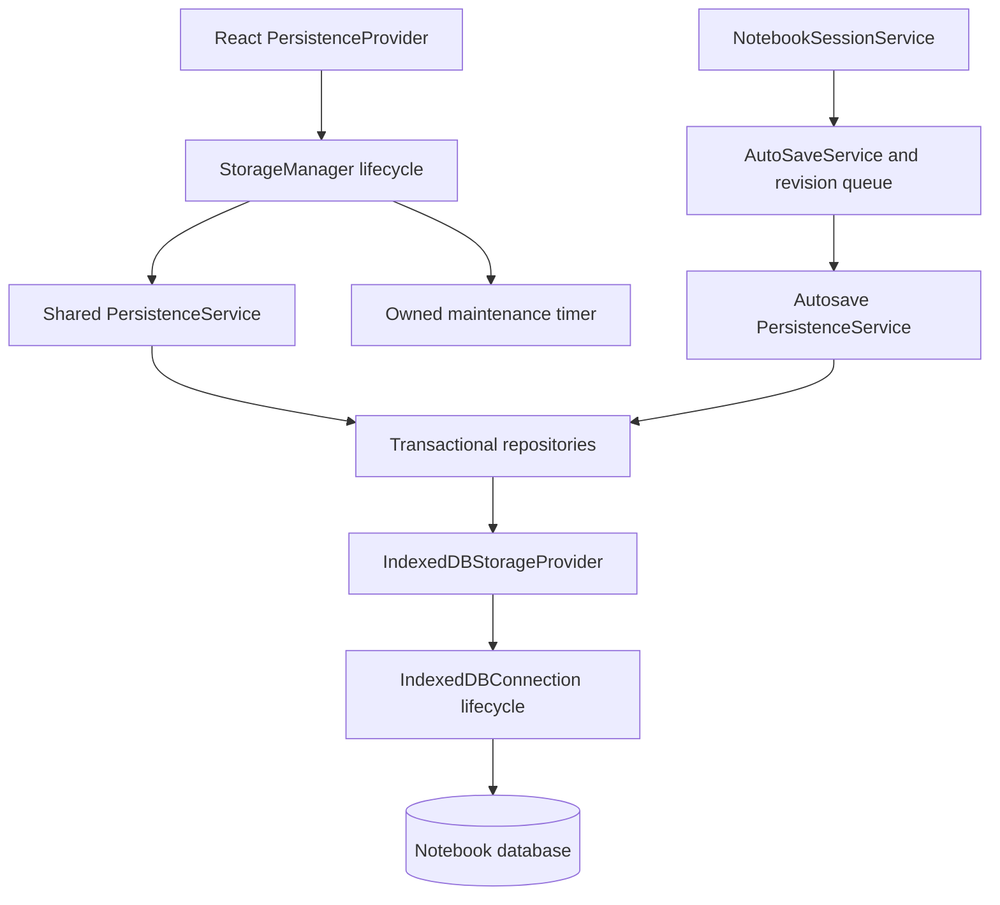

# Authoritative autosave publication

The service owns save state. Zustand projects the complete frozen state attached to
each event; it does not infer clean/dirty state from event names. Store bindings can
be unsubscribed, and the application's binding is released on Vite hot disposal.
The unused internal `setDirty` action was removed: queued snapshots determine dirty
state. Error dismissal is a service operation shared by all projections.

## Runtime ownership

The application provider enters the maintenance lifecycle before rendering children:
configuration initialization and migration checks precede periodic scheduling. It closes
through the same owner, cancelling the timer and draining admitted manager operations.
The React context exposes the shared repository service; it does not become a second
connection lifecycle owner. PreviewStore imports no longer start IndexedDB work or expose
an unused initialization action. Initial preview values and persisted-state filtering
already establish its empty preview state.

Autosave intentionally retains its independent service/connection, since hiding or
unmounting the page binding does not discard accepted saves. Both owners write the same
database under native transaction serialization. This is not cross-tab revision conflict
resolution. The existing provider retry/error UI remains the initialization failure boundary.

## Commit boundary

The current snapshot writer stores notebook metadata, activity, file metadata and
file content in one repository transaction. FileRecordSet prepares and writes the
same file representation for standalone file saves and notebook snapshot saves.
Access metadata updates and content reads use transaction-owned records so they
cannot overwrite a concurrent save with a stale record.

After the write succeeds, the queue removes only the revision actually committed.
The service then publishes save_completed with that revision and the resulting full
state. If a newer revision is queued, every completion observer still sees dirty.
lastSavedAt is the commit acknowledgement time, not the snapshot creation time.
Loading another notebook does not clear pending saves. Clearing one queued notebook
preserves the pending count for all others.

Notifications are delivered FIFO. A listener submitting an edit during notification
cannot make a later listener regress to the previous state. Each event's state is
immutable; status-change notifications carry the same complete transition snapshot.

## Verification (2026-10-19)

The storage/persistence/autosave/session/recovery gate passes 299 tests across twenty-five files. Coverage includes
atomic repository writes, connection ownership, revision barriers, scoped fair
scheduling, retry deadlines, shutdown, pause and authoritative store publication.
Scheduler tests use deferred writes and virtual time; repository/provider tests use
transaction and IndexedDB event doubles. These are not native browser recovery tests.

Autosave lint passes without warnings. Full-project type checking still reports
297 existing diagnostics, none in autosave, persistence or session modules.

The preceding independent whole-project checkpoint passed 1,067 tests across 119 files (57.42s).
The restore-as-copy production build passes in 13.95s; oversized-chunk warnings remain.
An earlier checkpoint had an asynchronous math-rendering timeout when tests ran alongside
a production build; its isolated suite and subsequent independent runs passed.
Test timeouts were unchanged. A real-manager React integration test covers configuration
initialization, one periodic timer and unmount cleanup under StrictMode. A native provider
probe verifies actual IndexedDB configuration before rendering and close/remount behavior.

## Per-notebook save state and revision barriers

NotebookSaveQueue now owns each notebook's scheduled/writing/retry_wait/blocked/clean
transitions, latest snapshot, in-flight revision and committed revision. Progress
snapshots are immutable and available through getSaveProgress and notification
progress. A successful save of another notebook does not clear this notebook's
blocked progress or error. The existing global status/error remain a last-operation
projection; consumers needing notebook-specific truth must use its progress.

saveNow captures its accepted revision and waits through flushThrough. This barrier
resolves when that revision, or a newer coalesced snapshot, commits; edits accepted
afterward do not extend it. A failed stale snapshot can be replaced by a newer one
without rejecting the barrier prematurely. Retry exhaustion rejects pending barriers
and retains the snapshot for a later explicit retry. Invalid/future revisions reject
without scheduling I/O. An already committed barrier does not trigger another save.

Explicit discard rejects affected barriers and cannot discard an in-flight write.
Queue teardown rejects remaining barriers. The queue retains one progress entry per
encountered notebook until discard/clear, plus only pending/latest snapshots and
live barrier waiters; it does not keep an edit history. Revision numbers are local to
the service instance and are not persisted or a cross-window concurrency protocol.

## Graceful service shutdown

The service lifecycle is separate from individual notebook save phases:
active -> closing -> disposed. dispose() is now awaitable and idempotent while in
progress. It stops new admission synchronously, cancels automatic scheduling,
flushes previously accepted edits, waits for accepted reads/initialization and closes
its persistence connection. Only then does it publish disposed and release observers.
An accepted save remains valid even when its enqueue observer requests shutdown.

A save or connection-close failure rejects disposal and restores active admission;
unsaved snapshots are retained for retry. New writes, reads, initialization, pause,
resume and discard operations cannot enter while closing/disposed. Service
references remain terminal after disposal, including the singleton reference.
Singleton reset is an explicit asynchronous test teardown:
it discards pending edits but still waits for in-flight I/O and connection closure.
It is not the production shutdown policy.

## Pause admission and scheduling ownership

Scheduling now has its own running/pausing/paused state, independent of the latest
read/write status and the service lifecycle. Loading or manually saving while paused
does not resume automatic admission. queueSave rejects while paused instead of silently
dropping a submitted edit; resume explicitly restores scheduling. Session switching
and paused UI selectors use this authoritative state rather than the latest I/O status.

pause coalesces concurrent requests and continues accepting newer edits while draining.
It rechecks the queue after awaiting each drain; once empty, it closes automatic
admission synchronously without an intervening await. It no longer clears queue/history
as a substitute for saving. Supplied snapshots are captured before observers can submit
newer changes. resume during a pending drain rejects instead of racing its completion.
Failure restores the previous scheduling mode and retains pending data. An overlapping
failed disposal also leaves scheduling recoverable rather than stuck in pausing.

## Shared writer and scoped drains

NotebookSaveScheduler owns drain requests and the single writer. Each request covers
one notebook or the whole queue; an empty targeted drain does not write unrelated
pending notebooks. Among eligible notebooks, the least recently served gets the next
attempt. Targeted and full drains share this arbitration, so a continually edited
notebook cannot consume the writer exclusively. One in-flight write is never preempted.

Retry budgets and readiness deadlines belong to each notebook revision. Waiting for
A's retry permits B to write. Admission wakes a sleeping scheduler, and a new revision
bypasses its predecessor's backoff. Overlapping requests share the retry budget;
exhaustion rejects only requests covering that notebook and retains its snapshot.
An explicit subsequent request can retry it. Full drains continue other notebooks
before reporting failure. Debounced admission also participates while a writer is active.

waitForComplete observes currently active requests, preserving their failures without
admitting unrelated pending work. Internal teardown waits for the worker itself, wakes
retry timers and stops further attempts after the current write finishes. Discard and
normal idle completion release retry timers. The scheduler performs no persistence
serialization or UI publication; those responsibilities remain in AutoSaveService.

## Session boundary

Switching notebooks flushes the departing notebook by queue identity, without waiting
for unrelated saves or requiring the editor to still show that notebook. Disconnect
submits a final editor snapshot only when its ID matches the active session; otherwise
it drains already accepted snapshots without relabeling another notebook's content.

A failed pause keeps the session identity and reports a session error, allowing a
subsequent disconnect to retry persistence. A failed departure flush restores the
previous session phase before loading begins. Successful connection clears stale
operation errors. Twenty-two session regressions cover ownership, retries and load publication. Connection
success uses a fresh post-load store snapshot and verifies its notebook identity.
A false loader result rejects before publishing connected/loaded; a partially updated
store carrying an error is not reused as a successful cached load. Cached and loaded
connections share one success-publication path.

## Session state projection

Session events carry complete immutable service state, delivered FIFO even when a
listener clears an error during notification. The Zustand binding copies these
snapshots instead of reconstructing identity/status from event names. It initializes
from current service state, exposes explicit unsubscribe and releases its default
subscription on hot disposal. Commands delegate directly to the service, including
error dismissal; their rejected promises do not overwrite a newer published state.
Initialization failure and invalid IDs also publish service-owned errors. A successful
initialization retry clears the error, and successful connection records its timestamp.

## Session transition ownership

The session service serializes initialize/connect/disconnect/switch commands in
admission order. Each command includes its storage work and state publication;
internal switch-to-connect composition does not reacquire the queue. The departing
identity and same-notebook checks run when the command gets its turn, not when an
earlier transition may still be pending. A rejected command releases ownership while
preserving the caller's rejection. Commands submitted by event observers join the queue.

This service boundary protects direct callers as well as route navigation. The route
coordinator still coalesces pending destinations before dispatch; the service does not
drop commands already accepted through its public API. Seven deferred/concurrent
regressions cover switch order, pause-before-resume, duplicates, failure recovery,
return navigation, observer submissions and initialization deduplication.

## Browser page lifecycle

AppContent mounts a disposable AutoSavePageLifecycle binding. Hidden visibility and
pagehide request an immediate flush of accepted snapshots; edits accepted while
hidden also request a flush. Concurrent signals share an in-flight flush. The binding tracks
accepted-edit notifications separately from hide/unload signals and discarded queue entries.
Edits admitted after a flush starts request one follow-up if the page is still hidden and dirty,
even when the original flush fails while persisting a conflict copy. Edits admitted before the
flush starts are already covered. No further retry occurs without a new edit or lifecycle trigger.
A
beforeunload handler is attached only while authoritative dirty state is true and
removed after commit/discard. Failed saves retain dirty protection and report errors.

The binding never pauses or disposes storage when a page is hidden or React unmounts.
It removes only its own listeners, leaving independent unapplied-source-draft guards
intact. Cleanup cancels a flush not yet started; accepted writes remain owned by the
service. Fifteen EventTarget tests cover dirty guard updates, coalescing, failure/retry,
hidden edits, in-flight edit admission, shutdown admission and cleanup/remount ownership. A native
IndexedDB regression holds a conflict-recovery write open, admits a newer edit, then verifies
the follow-up persists that latest recovery copy while preserving the canonical notebook and
the pending-save guard.

The visibility trigger follows [MDN visibilitychange guidance](https://developer.mozilla.org/en-US/docs/Web/API/Document/visibilitychange_event).
EventTarget tests alone do not prove native dialog behavior. The Chromium suite
below adds that check; bfcache restoration and asynchronous completion during
browser/process termination remain unproven.

## Native Chromium verification

`npm run test:browser` runs seventy-nine isolated Playwright cases against production modules:
page reload persistence, native multi-store rollback, accepted-transaction draining
on close, retry after a blocked upgrade, normal browser-process restart with a temporary
profile, and the native unsaved-exit dialog followed by successful save/reload after
cancelling navigation. The runner starts its own Vite server and never uses a personal
browser profile. Setup and exact limits are in [the browser test README](../tests/browser/README.md).

These results add real IndexedDB/browser evidence to the 299 focused Vitest cases; they do
not claim crash/power-loss durability, bfcache behavior or other browser engines.

## Non-destructive database upgrades

Database version 5 retains the existing database name and records, and reconciles
missing stores/indexes through NotebookDatabaseSchema in the shared provider.
Unknown stores are retained; upgrades never delete existing stores. The retired raw
connection manager and unused TabCache/SplitPreviewCache implementations are removed.
Historical-data import retains its explicit reads of historical databases.

Native tests seed v2 data and verify preservation, including previously missing
split-files storage and notebook indexes. A conflicting unique index aborts the
version upgrade and preserves v2 records; no automatic data-loss repair is attempted.

## Atomic split-file cache clearing

SplitFileRepository clears one notebook through its notebookId index within one
readwrite transaction. Whole-cache clearing uses the native store clear operation
inside one transaction. Neither path enumerates records in one transaction and deletes
them later through independent transactions. Subsequent writes therefore run after
the clear transaction, and any failure rolls back the complete clear operation.
Native cases verify preservation of other notebooks, a concurrently admitted refresh,
and rollback of both scoped and whole-store deletion.

## Notebook ORM retirement

All internal notebook ORM callers now use NotebookRepository through the shared
storage persistence owner; LibraryService uses its already-injected repository.
The duplicate notebookOrm implementation and exports are removed. Storage helper
functions retain their application-facing signatures, and StorageManager.close now
also awaits the shared repository connection closing.

Activity recording, inactive-notebook queries, counter adjustment and recomputation
live in the repository. Statistics query notebook-indexed metadata and activities in
one readonly transaction. Counter updates and recomputation complete only on transaction
commit; no timeout can turn a pending write into success. Three native cases verify
concurrent counter increments, notebook-scoped statistics/retention, and rollback of
failed adjustments/recomputation. Configuration and activity maintenance now share the
same provider through StorageMaintenanceRepository.

## File ORM retirement and accounting

All internal file ORM callers now use FileRepository; the duplicate fileOrm module
and its exports are removed. Storage maintenance/imports reuse the existing persistence
singleton, and the extra storage composition instance is removed. Application FileCache
helpers retain their callable shape. Save inputs require file fields while allowing
callers to carry additional preview properties.

File creation/replacement, content changes and deletion commit metadata, content,
notebook counts/bytes and activity together. Reads update file/notebook access state
and activity under the same transaction. Large-file queries use the notebook index
when scoped and filter flags after reading; they never use invalid boolean IDB keys.
Old compression functions were identity operations, so historical payloads remain
readable as plain content even when marked compressed. Native cases exercise that
format, remote references, accounting across mutations, and full rollback on failure.

## Configuration and retention transactions

StorageMaintenanceRepository owns configuration initialization, patching and activity
retention. Each patch reads and writes in one readwrite transaction, preserving
concurrent disjoint updates. Initialization inserts defaults only when no record
exists. Activity cleanup uses the timestamp index and acknowledges transaction commit;
no timer or cursor exhaustion can report success before commit.

Native cases cover concurrent patches, retained settings, detached defaults, selective
retention, and rollback of configuration/activity writes on transaction failure.
StorageManager retains defaults for optional configuration reads; repository writes
and initialization propagate failure.

## Storage maintenance lifecycle

StorageMaintenanceLifecycle owns initialization, manager-operation admission, the periodic
timer and shutdown. States are idle, initializing, ready, closing, closed and close-failed.
Repeated initialization shares one attempt. Successful initialization schedules one timer;
failed initialization can retry. Periodic work schedules its next check after completion,
so slow checks cannot overlap themselves.

Close immediately cancels the timer and rejects new manager operations, then drains
initialization and every admitted multi-step operation before closing the provider.
An initialization finishing during close cannot restart scheduling. Explicit initialization
after successful close opens a new lifecycle; failed close requires a close retry first.
The manager boundary does not claim to stop independent callers of the shared repositories.

All manager operations participate in admission/draining, including manual cleanup and
migration. Internal steps remain part of the admitted operation and can finish during
shutdown. Destructive cleanup reads configuration strictly; only optional configuration
display retains default-on-read-error behavior. Nine lifecycle tests and five manager
integration tests cover timer ownership, admission, draining, retries and config failure.

## Atomic notebook retention

NotebookRetentionPolicy selects disjoint inactive and excess candidates from explicitly
evictable caches, retaining recent notebooks with a deterministic identity tie-break. Emergency cleanup retains the newest
70% of the configured notebook capacity. Invalid count/retention settings reject cleanup.
Preview and execution use the same policy, without the former 50-extra-notebook query cap.
Preview totals count each selected notebook's file metadata once.

Cleanup reads configuration and notebooks, chooses candidates, deletes owned records and
updates the regular-cleanup timestamp in one readwrite transaction. Native IndexedDB
serialization makes access or file writes admitted before cleanup visible to selection.
File mutation refreshes notebook recency. Overlapping forced/emergency requests serialize;
ordinary cleanup stays excluded while any accepted cleanup remains pending.

NotebookDeletion is shared by explicit deletion and maintenance. It removes file metadata,
content, activities, tab state and split cache within the caller's transaction. Failed
cleanup rolls back every store and config update, and reports no committed statistics.
Reported bytes are file metadata sizes, not a browser quota/physical-disk measurement.
Native tests cover over-capacity batches, emergency LRU order, refreshed access/write,
full cascade and rollback, explicit deletion isolation and overlapping cleanup accounting.

## Persistent document protection

Notebook retention identity is `persistent` or `evictable`. Missing identity is treated as
persistent: neither cacheEnabled nor a remote URL proves that document content can be
recovered. Current autosave writes local-only content, not a confirmed remote replica.
Automatic regular/emergency cleanup therefore selects only explicitly evictable caches;
protected documents do not consume this cache-count allowance.

Snapshot persistence atomically promotes its notebook to persistent with the content write.
Metadata refresh cannot downgrade an existing persistent or unclassified notebook. A new
explicit cache may opt into eviction; current application document creation stays persistent.
No database version change is needed for this optional record field. Historical content
remains protected without a destructive classification migration. Explicit notebook deletion
retains its behavior and can remove a persistent document and its owned records.

Native coverage saves a document over an evictable record, runs both cleanup modes with
zero capacity/retention, reloads the page and reads the only local content successfully.
Unclassified historical records survive the same cleanup; an explicit cache is removed.

## Storage usage snapshot

StorageManager delegates usage statistics to one readonly transaction over notebooks,
file metadata, file content, split content and recovery records. Logical totals retain the existing meaning:
file metadata sizes for existing notebooks, including remote references. Denormalized
notebook counters and unrelated activity logs are not used to calculate these totals.

localContentBytes and splitContentBytes count UTF-8 bytes of canonical/split strings.
recoveryCopies counts independent draft records; recoveryContentBytes and
recoveryBaselineBytes count their snapshot and comparison-base strings separately.
totalContentBytes sums all four payload byte categories. Null bases cost zero; equal
strings in distinct records are counted separately because both records store them.

Content is consumed through cursors rather than materializing all payload stores in memory.
orphanContentBytes remains a subset of canonical/split totals: bodies without associated
metadata/notebook and splits without notebooks. Recovery has independent ownership and is
not an orphan just because its original notebook was deleted. None of these fields includes
record/index overhead or claims to measure physical disk usage. Malformed recovery payloads
reject measurement rather than silently undercounting. Empty stores report explicit zeros.

Reporting, preview and cleanup share one declared usage store scope. Recovery saves,
restorations and dismissals therefore serialize with these snapshots, including when a
recovery record is atomically consumed to create canonical content. Native cases verify
multibyte text, baseline bytes, unchanged legacy logical sizes, empty records, orphan
classification, protected over-budget bytes and complete snapshots during restoration.

## Content budget enforcement

Regular cleanup applies maxTotalSize to UTF-8 canonical, split, recovery and baseline text bytes. Emergency
cleanup targets 70% of that allowance, alongside its cache-count target. Age/count
candidates are accounted first, then the oldest remaining payload-bearing evictable
notebooks are selected until the target is met or no reclaimable content remains.
Zero-byte/remote-only caches are not deleted merely because other content exceeds
the byte budget. Persistent documents, orphan payloads and recovery records are included in usage but
are never selected for automatic deletion. Recovery bytes are not credited to any notebook
eviction: even deleting their original notebook leaves them retained. Unreclaimable recovery
bytes remain in remainingContentBytes and overBudgetBytes.

Usage reading is shared by reporting, preview and cleanup. Cleanup measures/selects/deletes
within the same readwrite transaction. Both preview and committed results expose
contentBytesFreed, remainingContentBytes and overBudgetBytes; the existing bytesFreed
and totalBytesToFree remain logical file-metadata totals. A nonzero overBudgetBytes
explicitly means protected/unowned content prevents meeting the target. No write-admission
cap or physical browser quota guarantee is claimed. Read or commit failures reject the
operation without publishing committed totals. Content budget must be a nonnegative
safe integer; invalid persisted budgets cannot trigger cleanup.

Policy tests cover LRU, emergency targets, invalid budgets and un-reclaimable pressure.
Native tests cover multibyte local/split payloads, preview/execute agreement, remote-only
cache preservation, zero budgets with protected data, and transaction rollback.

## Transaction-owned notebook accounting

Notebook metadata saves derive fileCount and totalSize from notebook-indexed file metadata
inside the save transaction. Snapshot replacement excludes the old snapshot and includes
its replacement exactly once; unrelated files remain counted. Callers may pass existing
metadata objects, but file-derived counters are optional inputs and are never authoritative.
Access count and recency do not regress when a stale metadata object is saved.

AutoSaveService measures the complete serialized snapshot for its file record and no longer
computes redundant per-cell size estimates or treats cell count as file count. The obsolete
WeakMap size cache is removed. FileCache creation starts with no pre-counted file, and its
existing-notebook read no longer triggers an additional metadata write/access increment.
Native cases cover create/replace, additional files, concurrent stale refresh and rollback
of content, counters and retention promotion on failed commit.

## Atomic file parent ownership

File creation and content updates establish a missing notebook parent within their existing
multi-store write transaction. The new parent is persistent, and its counters include all
notebook-indexed metadata already present in that transaction, including historical orphan
files. Concurrent first writes serialize and produce one parent with accumulated totals.
Existing parent identity is retained. Deleting an orphan file never creates a parent.

FileCache delegates directly to FileRepository after input conversion; its separate parent
creation and swallowed-failure path are removed. No parent or child write survives an
aborted initial save. Native tests cover concurrent first writes, orphan content updates,
complete rollback and non-resurrection during deletion. Existing orphan content is not
swept automatically; ownership is established only through an explicitly requested write.

## Configuration validation and storage thresholds

StorageConfiguration validates nonnegative safe-integer limits/times, record identity and
the compression flag. Repository reads and initialization reject malformed saved settings;
patch updates validate the merged record before writing and can repair an invalid field.
Retention uses the same validator instead of a separate subset of validation rules.
Optional manager configuration display keeps its existing logged default behavior.

FileRepository reads configuration in the file-save transaction and applies maxFileSize
unless an explicit per-save threshold overrides it. Threshold updates admitted before a
save therefore determine that save's storage mode. FileRecordSet also rejects invalid file
sizes/explicit thresholds. Only files with a usable remote reference may become remote-only;
NotebookRepository snapshots retain forced-local content independently of cache configuration.
The compression flag remains accepted configuration; no compression codec is claimed.

Native tests cover threshold changes, local-content removal on a remote transition, explicit
overrides, forced-local snapshots, invalid patch rollback and repairing malformed settings
before cache writes resume. Configuration unit tests cover every numeric field and detached
default values.

## Append-only activity records

Notebook and file repositories construct activity records through NotebookActivityRecord,
using the existing uuid dependency for event identity. Millisecond timestamp and file path
no longer determine the primary key, so repeated operations in one clock tick remain
separate events. Existing timestamp/notebook indexes continue to serve temporal queries;
historical IDs remain readable without a schema upgrade.

Activity writes use add rather than put. A key collision rejects the transaction instead
of overwriting prior history; file data, notebook counters and activity remain atomic.
Explicit logActivity now uses the same transactional append contract. A frozen-clock native
test verifies all fourteen notebook/file events survive, and an injected duplicate key test
verifies existing history remains intact while the associated file write rolls back.

## Invocation-time write inputs

Repository entry points capture scalar notebook/file/configuration data and file options
before awaiting configuration or current records. The manager configuration facade and
FileCache facade capture input before lifecycle deferral or dynamic import. A save cannot
therefore acquire a different notebook identity or content because its caller reuses an
object while the operation is pending.

Provider put captures a structured clone before opening storage, and activity records copy
nested metadata at construction. Unsupported structured values reject without opening a
connection; there is no JSON conversion fallback. Transaction store-name arrays are also
copied before asynchronous initialization. Repository callbacks remain responsible for any
other application-owned values they capture.

Native tests mutate objects immediately after invoking writes and verify cold-provider
nested values, notebook/file identities and options, snapshot association, config patches,
activity metadata, transaction scope and the application FileCache facade. Manager unit
coverage verifies capture before lifecycle deferral.

## Remote-to-local file transitions

FileRecordSet prepares both new files and explicit local content updates. A local update
writes local storageType, hasLocalContent, cleared isLargeFile/contentPreview and the new
UTF-8 body together. It preserves cachedAt/accessCount from the transaction's existing
revision and retains the remote URL as provenance. No remote refetch is required for the
newly edited content, even if that content exceeds the optional cache threshold.

FileRepository no longer maintains a separate metadata/body construction path for updates.
Its notebook accounting and activity append remain in the same transaction. Native tests
verify history preservation, corrected large-file queries/usage statistics, and complete
rollback to the original remote revision when commit fails.

## Historical source read lifecycle

LegacyDatabaseReader owns one opening/reading/settled attempt. It reads every matching
file/cache store in one readonly transaction and publishes only after transaction
completion. Missing database probes abort creation. Every terminal path clears the
source deadline and releases its connection; timeouts abort active reads, and late
opens close without starting reads. Destination writes begin only after a complete
source read and are awaited without an independent source timeout.

Eight deterministic reader tests cover completion, timeout, late callbacks, blocked
opens, abort and version change. Native tests verify absent probes leave no database,
multiple source stores are imported, and historical source records remain unchanged.
NotebookImport captures a notebook batch before asynchronous admission. One readwrite
transaction compares destination metadata/body records, adds missing files, recomputes
counters and appends activity. Equal local bodies are skipped without changing destination
metadata. Conflicting source duplicates or destination records reject the entire notebook.
Concurrent imports serialize on the same store scope; a retry creates no extra activity.
New records use add, so an unexpected key collision aborts instead of overwriting.

Migration now calls this operation instead of separate notebook/file saves. forceMigration
retries the same non-destructive path and never clears destination documents. Startup
probes source databases even when the destination already has other notebooks. Counts
include only newly committed files and notebooks with committed additions. Atomicity is
per notebook, not across every historical database; errors remain visible in MigrationStats.
Native tests cover rollback, two concurrent connections, repeat no-op, missing-file merge,
source/destination conflicts, preserved names and forced migration preservation.

## Historical input boundary

LegacyDatabaseReader returns unknown records, not an unchecked historical interface.
LegacyMigrationPlan owns validation and notebook grouping before destination admission.
Identity, path, name and string content are required. Empty content is valid; absent,
null or non-string content is an error and never becomes an invented empty file.
A malformed identifiable record rejects its entire notebook batch, while independent
valid notebooks remain importable. Unidentifiable records are reported explicitly.

Optional numeric metadata defaults only when absent and otherwise must be nonnegative
safe integers. Zero timestamps/counts remain zero. Missing size is derived from UTF-8
content bytes; valid historical logical size is preserved. Validation produces detached
FileSaveData and NotebookSaveData; migration orchestration no longer owns normalization.
Native coverage verifies mixed valid/damaged records, no partial damaged notebook,
correct UTF-8 accounting, actual empty content and unchanged historical source records.

## Restoring import ownership

An import is a no-op only when both matching files and their parent notebook exist.
If the parent is missing, the same conflict-checked transaction restores it from the
import metadata, derives counters from all destination files (including files absent
from the source batch), and preserves their maximum access time/count. Existing file
metadata and bodies are not rewritten. A failed commit or source-content conflict
leaves the original orphan records untouched. Repeating the successful repair adds
no activity, and an empty batch does not create a notebook.

The import method retains its numeric return contract: only newly inserted files are
counted. Migration counters describe additions, not parent-only ownership repairs.
This is targeted restoration when source and destination agree, not a general orphan
recovery scan or permission to invent missing file bodies.

## Durable migration ledger

Version 4 adds migration_ledger without changing the database name or clearing existing
records. Current v2/v3/v4 upgrade tests verify retained data and the added stores. Ledger entries
are keyed by notebook ID and record completed source databases or a deleted terminal state.
NotebookMigrationLedger owns these transitions inside the caller's IndexedDB transaction.

Source-aware imports read the ledger before checking destination files. Successful imports
and equal-content acknowledgements record completion in the same transaction; failed
imports leave no receipt. Each source is treated as a one-time notebook snapshot, not an
ongoing synchronization feed. Later edits in a completed historical source are not applied.
Direct repository imports without a source retain their existing behavior.

NotebookDeletion writes a durable deletion marker alongside its cascade. This also covers
deleting a notebook before any migration. The ledger survives deletion, and its deleted
state blocks both known and previously unseen historical sources, including forceMigration.
No timeout or retention job clears these markers. Reload tests confirm deleted migrated
notebooks remain absent while the original historical database remains intact.

Existing deletions made before this ledger was introduced cannot be inferred retroactively.
Clearing the entire application database also clears its migration history; no guarantee
survives that explicit data reset. A user-facing historical recovery action would need an
explicit policy rather than silently bypassing deletion markers.

## Atomic empty-snapshot protection

The autosave read path returns the decoded document and its exact stored body internally;
public load results are unchanged. An empty snapshot still rejects nonempty, unavailable or
malformed stored content. If that semantic check passes, it supplies the observed body
(or a null absence marker) as a snapshot write condition.

NotebookRepository compares this condition against current metadata/content within the
same readwrite transaction that commits the snapshot, counters and activity. Absence means
both metadata and body are absent, so orphan content is not treated as an empty slot.
An unavailable or changed body rejects the transaction before snapshot mutations.
The condition is captured at invocation; existing callers may omit it.

Native tests interleave another connection's nonempty commit between the autosave check
and write, with both missing and initially empty content. The conditional commit rejects,
the queue retains its revision and blocks immediately without an automatic retry. Additional
coverage verifies matching revisions succeed and orphan-body conflicts preserve all stores.
Empty-save validation now shares the fixed edit baseline described below. Byte equality
is not a durable revision token and does not detect identical-content ABA changes.

## Cross-window edit baselines

NotebookWriteBaseline records the exact persisted body used by this service instance.
Successful public load adopts that body; a successful own commit advances it before save
notifications. Every nonempty autosave passes this fixed body to the transactional snapshot
condition. A never-loaded notebook requires file absence on first save rather than silently
adopting an existing file. Empty-save semantic checks retain their existing behavior, but
cannot replace a previously established baseline with another window's newer body.

Failed writes, retries and additional local edits leave the baseline unchanged. Therefore a
conflicted queue stays pending and cannot overwrite another window merely by retrying.
Public load first drains pending edits; a conflict prevents a reload from silently discarding
them. A load overtaken by a queued edit or by a newer differing committed baseline rejects
without publishing loaded content. Concurrent equal loads remain valid.

A native two-page test verifies sequential own saves, rejection of an unloaded overwrite,
competing nonempty edits, repeat rejection and preservation of the winner's persisted body.
Unit tests cover pending/committed edits overtaking loads and baseline ownership transitions.
This provides optimistic content conflict detection for AutoSaveService clients, not merging,
a revision history, cross-device coordination or protection from unconditional repository
callers. Committed conflict snapshots have the durable recovery path and download/deletion
entry described below, including atomic restore-as-copy. Automatic merging remains future work.

## Terminal save conflicts

NotebookConflictError identifies content-version mismatch and empty-overwrite refusal
without classifying errors by message text. Autosave supplies the retry policy to its
storage-independent scheduler: these semantic conflicts block immediately, while ordinary
write failures retain the bounded retry behavior. The queue remains dirty and does not
acknowledge the rejected revision.

A terminal conflict also blocks a newer local snapshot admitted during the failing write.
The newest snapshot remains queued and affected barriers reject; it is not automatically
written against the same incompatible baseline. The active drain continues other notebooks.
An explicit later flush can attempt the retained revision, still under the original condition.
Deterministic tests verify no retry timer, one write attempt, independent notebook progress,
barrier rejection and latest-snapshot preservation. Native cross-window tests verify the
original version conflict is now returned immediately rather than masked by a retry.

## Durable conflict drafts

Version 5 adds notebook_recovery. NotebookSnapshotDocument prepares the existing notebook
JSON once for a canonical write and supplies the same serialization format for recovery.
On NotebookConflictError, autosave captures the currently queued snapshot and awaits its
recovery transaction before publishing the failure. The canonical queue remains pending;
a saved recovery draft never acknowledges a main-document revision. If recovery also fails,
the error explicitly includes that failure and the in-memory snapshot remains pending.

Each service instance has a UUID writer identity. NotebookRecoveryRepository owns one row
per writer/notebook and compares local revision numbers in its transaction. Older writes
cannot replace newer drafts; an equal revision must have equal content and preserves its
original comparison baseline. Drafts from separate windows remain independent. Repository
listDrafts exposes persisted records after reload; discardDraft compares the observed
revision before deleting so a stale action cannot discard a newer draft.

Recovery records survive notebook deletion and cache cleanup. They are retained until an
explicit recovery action; even a later successful main save does not silently discard them.
Their body/base bytes are measured independently and included in total content budgeting. A normal reload test
retrieves both an unloaded overwrite attempt and a stale-window edit while the canonical
winning document remains unchanged. Native tests cover monotonic updates, writer isolation,
transaction abort, invocation-time capture, compare-delete and notebook deletion isolation.

Durability begins at recovery transaction completion, not at keystroke admission. Edits
admitted after recovery capture remain queued and need their own save attempt. This is not
a guarantee against process termination before commit or disk/power loss. The recovery entry below supports viewing/export/deletion and atomic restore-as-copy;
automatic merging is not implemented.

## Application recovery entry

App mounts NotebookRecoveryCenter inside the existing persistence/theme providers. It
shows recovery copies when records are available and exposes preview, raw JSON download,
refresh and explicitly confirmed deletion. Download does not delete a recovery record or
acknowledge a pending save. Recovery storage failures still expose an Unsaved edits entry
with the actual failure, even when no downloadable record exists. Per-notebook save failure
messages clear only after that notebook successfully commits.

NotebookRecoveryController owns idle/loading/ready/deleting/restoring/failed UI data transitions.
Generations suppress delayed read results after a newer refresh or deletion. Accepted deletes
block duplicate mutations and refresh their final list. Refresh notifications received while a
mutation is busy advance an invalidation version. Notifications before the final read coalesce
into that read; notifications during it cause another read before publishing. An invalidated
read failure likewise honors the queued refresh, without retrying the mutation. A read failure
without a newer notification remains visible and does not automatically retry.
A confirmation captures the displayed
record's revision; concurrent replacement causes compare-delete to reject and the newer copy
to be displayed. Controller snapshots are immutable; React only owns presentation state.
Refresh is event-driven on mount, opening, window focus and save failure, with subscriptions
released on unmount. No polling or main-document overwrite is introduced.

Native UI tests use the production provider and components to inspect a copy, compare the
actual downloaded bytes, interleave a newer write during deletion confirmation, preserve the
canonical document, discover a live conflict and report failed recovery writes. Controller tests cover stale reads, mutation races, failures, duplicate admission and
retention of committed restoration links. The entry is mounted
in App rather than in the persistence provider, keeping infrastructure independent of UI.

## Restore a recovery copy as a new notebook

NotebookRecoveryRepository.restoreDraft compares the reviewed draft revision inside a
readwrite transaction spanning recovery, notebook, file metadata/body and activity stores.
A new UUID identifies the destination. RecoveredNotebookCopy validates source identity and
basic document/cell shape, preserves cell contents, outputs, tasks and extra fields, and
updates the notebook identity, recovered title and save timestamp. FileRecordSet prepares
forced-local content and UTF-8 accounting; the new notebook is persistent.

Destination records use add, and an identity already owning file metadata is rejected.
The source recovery record is consumed only in the same successful transaction. A stale or
missing source returns no copy; malformed source, key collision or commit failure leaves
the draft intact. Two concurrent restores of one revision create one notebook. The original
canonical notebook and its pending autosave queue are not modified or acknowledged.

The recovery center offers Restore as new notebook, then an Open recovered notebook link
in a separate tab using the configured browser/hash route. The controller shares mutation
admission between delete/restore and preserves a committed copy link even when follow-up
listing fails or an action is retried against a consumed record. Closing and reopening the
center retains this link for the current application lifetime. A later application load can
find the created notebook through normal persistent notebook records.

Native tests verify stale revision rejection, transaction rollback, ID collision, concurrent
restore, an intact original document, the link target and successful AutoSaveService loading
of the new copy. Parser tests preserve arbitrary payload fields and reject malformed input.
Restoration is an explicit copy operation; original pending edits can still produce further
recovery records, and the original window remains protected by its unsaved-exit guard.

## Remaining lifecycle work

Historical migration conflicts are reported and preserve both sources; there is no conflict
resolution UI or automatic choice of a winning historical revision. Startup probing is
repeatable; completed source snapshots and subsequent deletions are now recorded durably.
General orphan recovery beyond verified source imports remains unimplemented.

Retention now enforces cache count, inactivity and an application content budget.
The production caller audit found no explicit evictable notebook creation. Current editing
uses persistent documents, so automatic eviction does not require an active-cache lease.
A future caller opting into eviction must define recoverability and active-use protection.
Persistent documents are protected regardless of age or count; this does not expand
browser storage quota or claim remote synchronization.
A transaction accepted after deletion cannot retroactively protect the deleted notebook.

Pause waits for quiescence and is not guaranteed to finish under an infinite stream of accepted edits;
application-level producer cancellation remains relevant. Cross-window conflicts,
crash recovery, native application close coordination and broader browser lifecycle validation remain. Browser termination
cannot guarantee awaiting asynchronous writes. No crash-durability or cross-session
version guarantee is claimed.
